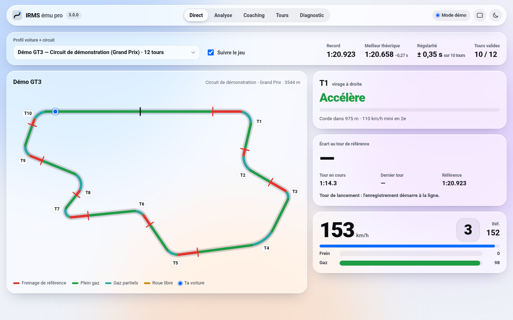
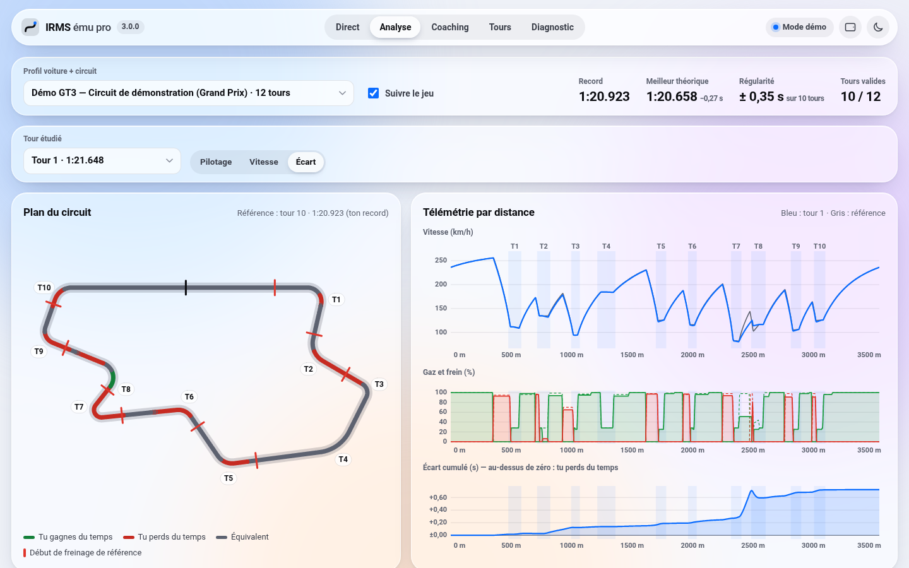
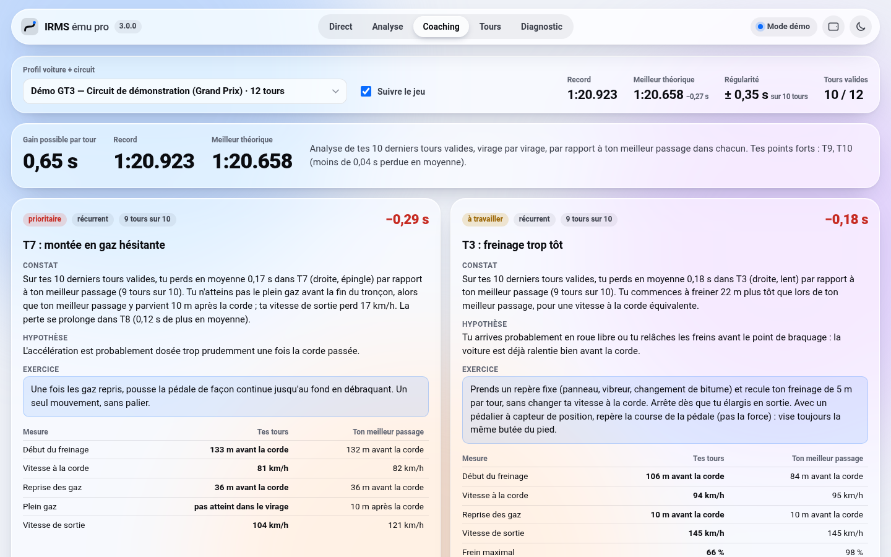
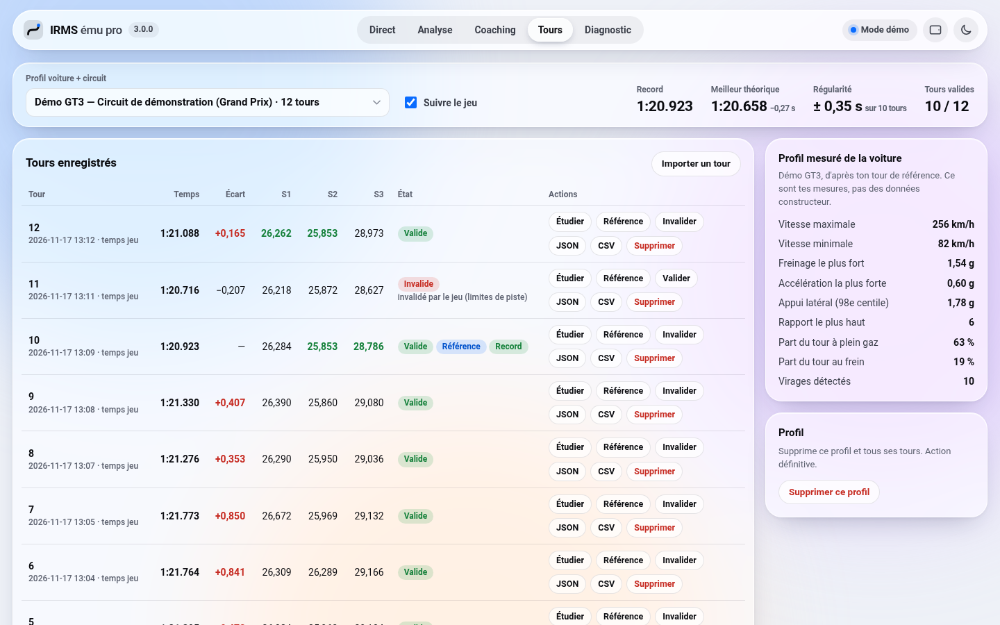
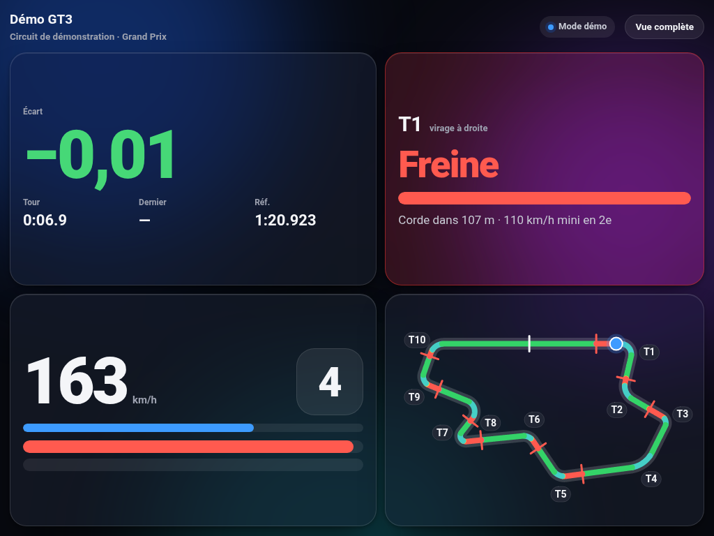

# IRMS ému pro

Télémétrie et coaching local pour **Assetto Corsa EVO**. L'application lit les données que le jeu publie pendant que tu roules, reconnaît la voiture et le circuit, enregistre tes tours, puis te montre où tu freines, où tu remets les gaz et où tu perds du temps, virage par virage.

Version 3.0.0 · Windows 10/11 · Python 3.9 ou plus récent · aucune dépendance à installer · licence MIT



> English summary at the [bottom of this page](#english-summary).

## Ce que fait l'application

- **Détection automatique de la voiture et du circuit.** Dès que tu entres en piste, IRMS ouvre le bon profil (voiture + circuit + tracé). Changer de voiture ouvre un autre profil : les repères et les temps ne sont jamais mélangés.
- **Plan du circuit tracé à partir de tes propres tours.** Aucune base de circuits à télécharger : le plan, les virages et les tronçons sont calculés à partir de ta trajectoire.
- **Repères de pilotage sur le plan.** Zones de freinage, de gaz partiels, de roue libre et de plein gaz du tour de référence, avec le début de freinage de chaque virage.
- **Aide en direct.** Prochain virage, distance avant la corde, vitesse minimale et rapport de ton meilleur tour, consigne courte (accélère, prépare le freinage, freine, vise la corde), écart en temps réel au tour de référence.
- **Analyse d'un tour.** Vitesse, gaz, frein et écart cumulé superposés au tour de référence, zoom sur un virage, tableau des tronçons.
- **Coaching sur tes points faibles.** Pour chaque virage où tu perds du temps : un constat chiffré, une hypothèse, un exercice. Les conseils distinguent une erreur récurrente d'une erreur isolée et s'adaptent à ton pédalier (capteur de position ou cellule de charge).
- **Gestion des tours.** Temps par secteur, record, meilleur tour théorique, régularité, tours invalidés par le jeu, export et import (JSON, CSV).
- **Affichage sur tablette.** Une vue simplifiée, lisible sur un iPad posé près du volant, en lecture seule sur le réseau local.
- **Mode démonstration.** Toute l'application avec des données simulées, sans le jeu.

| Analyse | Coaching |
| --- | --- |
|  |  |

| Tours | iPad |
| --- | --- |
|  |  |

## Démarrage rapide (Windows)

1. Installe Python depuis [python.org](https://www.python.org/downloads/windows/) en cochant **Add python.exe to PATH**.
2. Télécharge ce dépôt (bouton **Code**, puis **Download ZIP**) et décompresse-le.
3. Double-clique sur **`DEMARRER_DEMO.bat`** pour découvrir l'application sans le jeu, ou sur **`DEMARRER_IRMS.bat`** puis lance Assetto Corsa EVO et entre en piste.

Le guide pas à pas, une action à la fois, est dans [`INSTALLATION_WINDOWS.txt`](INSTALLATION_WINDOWS.txt).

| Fichier | Rôle |
| --- | --- |
| `DEMARRER_IRMS.bat` | Utilisation normale avec le jeu, sur ce PC uniquement. |
| `DEMARRER_IPAD.bat` | Comme ci-dessus, et l'iPad du même réseau Wi-Fi peut afficher la vue tablette (lecture seule). |
| `DEMARRER_DEMO.bat` | Données simulées, sans le jeu. |
| `DIAGNOSTIC_EVO.bat` | Vérifie la connexion au jeu et prépare un rapport pour un signalement. |

En ligne de commande, sur n'importe quel système :

```
python -m irms demo            # démonstration
python -m irms run             # connexion au jeu (Windows)
python -m irms run --lan       # + tablette en lecture seule
python -m irms doctor          # diagnostic
python -m irms --help
```

## État du projet : ce qui est vérifié, ce qui ne l'est pas

Ce projet préfère dire ce qu'il ne sait pas plutôt que d'afficher des chiffres faux.

**Vérifié automatiquement** (130 tests, voir [`tests/`](tests)) :

- la disposition mémoire des trois pages du jeu est identique, champ par champ, à celle que produit un compilateur C++ à partir de l'en-tête de la documentation Shared Memory du jeu (11 structures, 349 champs) ;
- une capture mémoire réelle d'Assetto Corsa EVO 0.6.2 (Brands Hatch Indy, Dallara EXP) est décodée correctement ;
- toute la chaîne (lecture de zones mémoire Windows nommées, enregistrement des tours, analyse, conseils, serveur) fonctionne avec un faux jeu qui publie des tours simulés ;
- les protections du serveur local (accès réseau en lecture seule, refus des requêtes venues d'autres sites, pas de fuite de fichiers).

**Pas encore vérifié** — les retours sont bienvenus :

- le comportement avec les versions du jeu postérieures à 0.6.2 (le jeu est en accès anticipé et sa mémoire partagée peut changer ; voir [`docs/CONNECTEUR_EVO.md`](docs/CONNECTEUR_EVO.md)) ;
- le comportement du jeu dans les menus, en pause et en rediffusion ;
- le rendu sur un vrai iPad ancien (le code évite les fonctions récentes de Safari, mais seul un essai réel le confirme) ;
- la justesse des conseils sur de vrais tours : les seuils ont été réglés sur des tours simulés.

Si IRMS reçoit des données incohérentes (par exemple après une mise à jour du jeu), il **suspend l'enregistrement** et l'indique dans l'onglet Diagnostic au lieu d'enregistrer des tours faux.

## Comment ça marche

```
Assetto Corsa EVO ──(mémoire partagée, lecture seule)──> evo_reader ──> recorder ──> storage (SQLite)
                                                                              │
                                              navigateur <── server (HTTP local) <── analysis + coaching
```

- Le jeu publie trois zones de mémoire partagée (`physics`, `graphics`, `static`). IRMS les ouvre en lecture seule ; il n'écrit rien dans le jeu et ne modifie aucun fichier du jeu.
- Les tours sont rangés par profil voiture + circuit + tracé dans une base SQLite locale.
- Les virages, les tronçons et les conseils sont recalculés à partir de tes tours ; la cible est **ton meilleur passage** dans chaque virage, avec la même voiture.

Pour aller plus loin : [architecture](docs/ARCHITECTURE.md), [connecteur EVO](docs/CONNECTEUR_EVO.md), [méthode de coaching](docs/COACHING.md), [format des données et API](docs/FORMAT_DONNEES.md), [publier sur GitHub](docs/PUBLIER_SUR_GITHUB.md).

## Confidentialité et sécurité

- Tout reste sur ton PC. L'application ne contacte aucun serveur, ne charge aucune ressource externe et n'envoie aucune statistique.
- Ton nom de pilote n'est jamais enregistré, ni dans la base, ni dans les exports, ni dans le rapport de diagnostic.
- Par défaut, seul ce PC peut ouvrir l'application. Avec `DEMARRER_IPAD.bat`, les appareils du réseau local peuvent consulter mais pas modifier ni supprimer.
- Détails et signalement d'une faille : [`SECURITY.md`](SECURITY.md).

## Limites connues

- Windows uniquement pour la connexion au jeu (le mode démonstration fonctionne partout).
- Assetto Corsa EVO uniquement. Le premier Assetto Corsa utilise une autre disposition mémoire et n'est pas pris en charge.
- Les conseils comparent tes tours entre eux : ils te rapprochent de ton meilleur niveau actuel, ils ne connaissent pas le temps d'un pilote de référence.
- Il faut au moins un tour complet pour afficher le plan et trois tours valides pour les conseils.
- Les secteurs sont trois tiers égaux du tour, pas les secteurs officiels du circuit.

## Contribuer

Les signalements de compatibilité après une mise à jour du jeu sont la contribution la plus utile : lance `DIAGNOSTIC_EVO.bat` en piste et ouvre un signalement « Compatibilité EVO ». Pour le code, lis [`CONTRIBUTING.md`](CONTRIBUTING.md).

```
python -m unittest discover -s tests -t .
```

## Crédits et licence

Code sous licence [MIT](LICENSE). Sources et projets qui ont aidé à comprendre la mémoire partagée du jeu : voir [`THIRD_PARTY_NOTICES.md`](THIRD_PARTY_NOTICES.md).

Projet indépendant, sans lien avec Kunos Simulazioni, 505 Games ou Fanatec. Assetto Corsa EVO et les autres noms cités appartiennent à leurs propriétaires.

## English summary

IRMS ému pro is a local telemetry and driver-coaching tool for **Assetto Corsa EVO** on Windows. It reads the game's shared memory (read-only), detects the car and track automatically, records laps into a local SQLite database, draws the track map from your own laps, and shows braking points, throttle application, per-corner time loss and coaching advice based on your own best pass through each corner. It runs as a small local web server written in pure Python (3.9+, standard library only) with a plain HTML/CSS/JS interface, including a simplified read-only tablet view for the local network.

Quick start: install Python, download the repository, run `python -m irms demo` (simulated data, any OS) or `python -m irms run` (Windows, with the game on track). The interface and documentation are in French. Layout offsets are tested against the game's documented C++ header and against a real EVO 0.6.2 capture; later game builds may change the layout, in which case recording is suspended and reported rather than producing wrong data. MIT licensed, not affiliated with Kunos Simulazioni.
